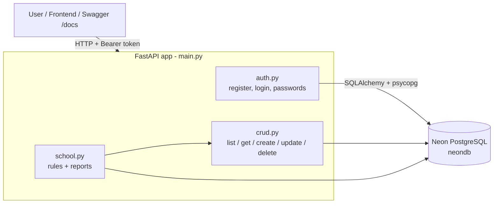
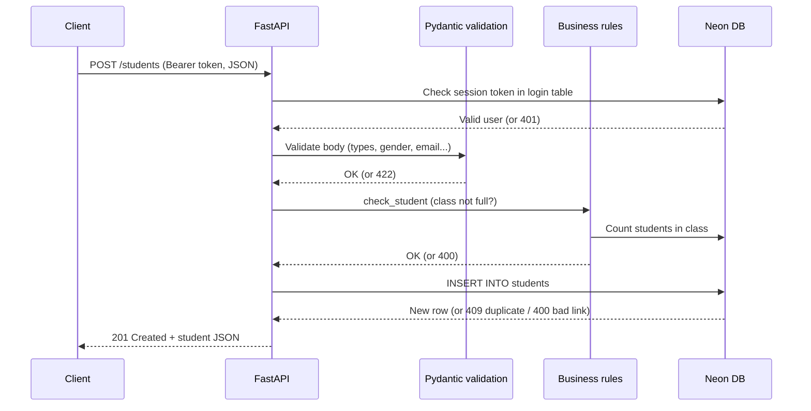
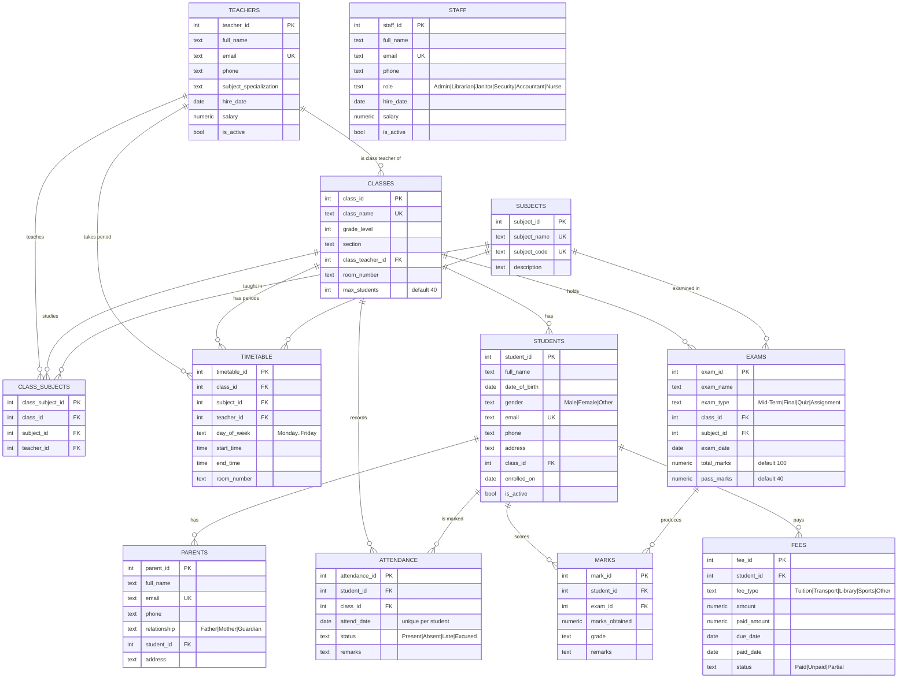
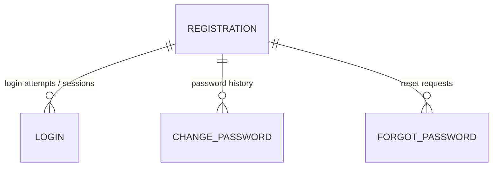
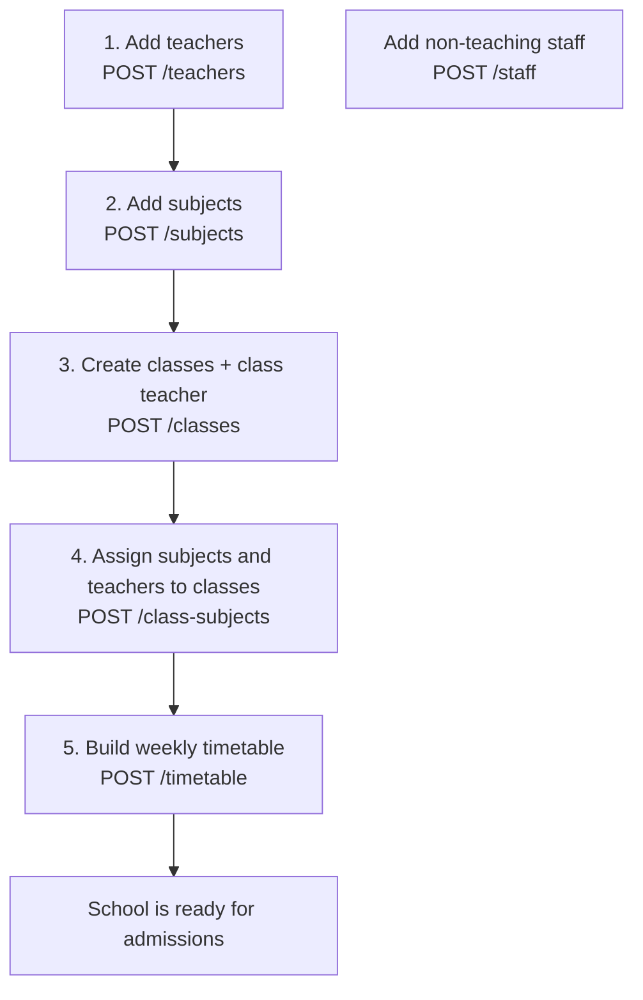
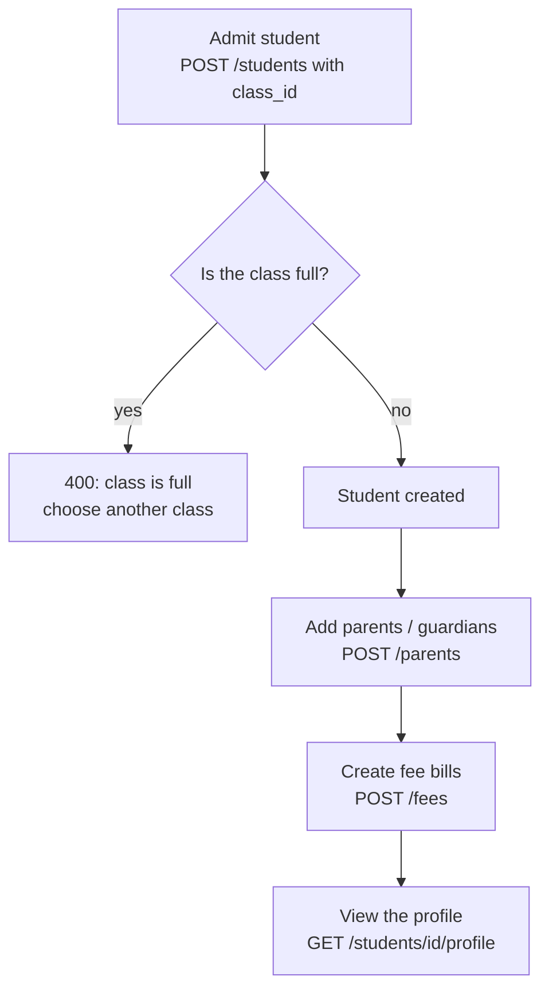
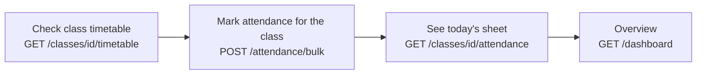
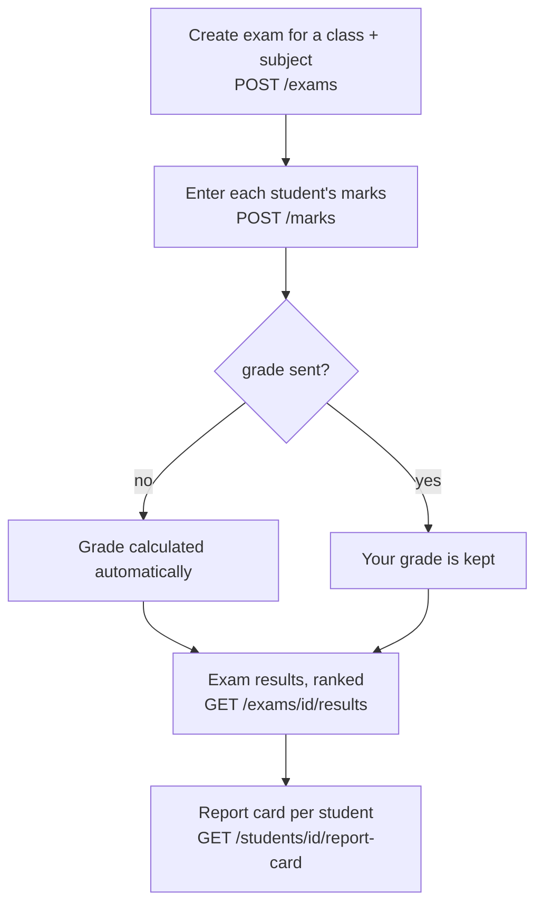
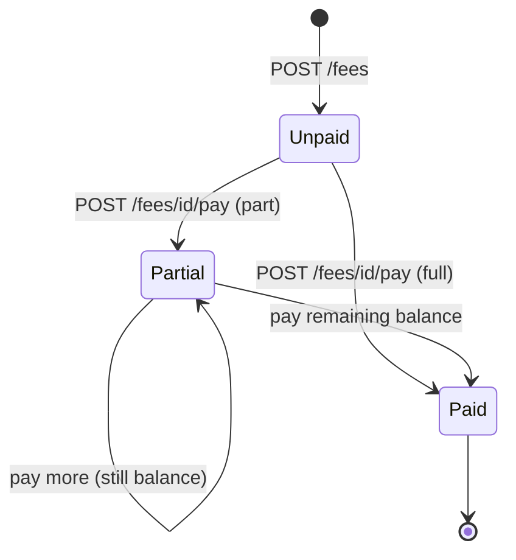

# School Management API: Guide

A FastAPI backend for the **school management database in Neon PostgreSQL**. It covers students, parents, teachers, staff, classes, subjects, timetable, attendance, exams, marks and fees.

> The diagrams use **Mermaid**. They render on GitHub, and in VS Code after installing the extension *"Markdown Preview Mermaid Support"* (then press `Cmd+Shift+V`).

---

## Contents
1. [Quick start](#1-quick-start)
2. [System architecture](#2-system-architecture)
3. [ER diagram](#3-er-diagram)
4. [Tables explained](#4-tables-explained)
5. [Complete school flow](#5-complete-school-flow)
6. [API endpoints](#6-api-endpoints)
7. [Business rules](#7-business-rules-enforced-by-the-api)
8. [Step-by-step examples](#8-step-by-step-examples)
9. [Errors](#9-error-codes)
10. [Project files](#10-project-files)

---

## 1. Quick start

```bash
cd /Users/synergy/Desktop/neondb
source .venv/bin/activate
pip install -r requirements.txt        # first time only
fastapi dev main.py --port 8000
```

Open **http://127.0.0.1:8000/docs**, then:

1. `POST /auth/login` with your email and password, and copy the `access_token`.
2. Click **Authorize** (top right), paste the token, and click **Authorize**.
3. Every school endpoint now works. Without the token they return **401**.

---

## 2. System architecture



**Request lifecycle**



---

## 3. ER diagram



`STAFF` (non-teaching staff) has no links to other tables.

### What happens on delete

| When you delete… | These are deleted too (CASCADE) | These are kept, link set to empty (SET NULL) |
|---|---|---|
| a **student** | parents, attendance, marks, fees | – |
| a **class** | class_subjects, timetable, attendance, exams (→ their marks) | students (`class_id` becomes null) |
| a **subject** | class_subjects, timetable, exams (→ their marks) | – |
| a **teacher** | timetable periods | classes (`class_teacher_id`), class_subjects (`teacher_id`) |
| an **exam** | marks | – |

> ⚠️ Deleting is permanent. To remove a student or teacher but keep their history, set `is_active` to `false` with **PATCH** instead.

### Login tables (separate from the school data)


These control **who can use the API**. See [README.md](README.md).

---

## 4. Tables explained

| Table | Purpose | Unique rule |
|---|---|---|
| `teachers` | Teaching staff | email |
| `staff` | Non-teaching staff (admin, librarian…) | email |
| `classes` | A class/section, e.g. *Grade 5A*, with an optional class teacher | class_name |
| `subjects` | Subjects offered, e.g. Mathematics (MATH101) | name, code |
| `students` | Students, each in one class | email |
| `parents` | Parent/guardian contacts of a student | email |
| `class_subjects` | Which subjects a class studies and **who teaches** each | (class, subject) |
| `timetable` | Weekly periods: class + subject + teacher + day + time | – |
| `attendance` | Daily status of each student | (student, date) |
| `exams` | An exam for one class and one subject | – |
| `marks` | A student's score in an exam | (student, exam) |
| `fees` | Fee bills and payments of a student | – |

---

## 5. Complete school flow

### 5.1 Setting up the school year



### 5.2 Student admission



### 5.3 Daily routine



### 5.4 Exams and results



### 5.5 Fee collection



Use `GET /fees/pending` to see who still owes money, and `GET /fees/pending?overdue_only=true` for bills past their due date.

---

## 6. API endpoints

All endpoints below need `Authorization: Bearer <access_token>`.

### Standard endpoints (every table)

Each of these resources gets the same 5 endpoints:

`/students` · `/parents` · `/teachers` · `/staff` · `/classes` · `/subjects` · `/class-subjects` · `/timetable` · `/attendance` · `/exams` · `/marks` · `/fees`

| Method | URL | Does |
|---|---|---|
| GET | `/students` | List (supports `skip`, `limit`, and filters) |
| GET | `/students/{id}` | Get one |
| POST | `/students` | Create |
| PATCH | `/students/{id}` | Update, sending **only the fields that change** |
| DELETE | `/students/{id}` | Delete (see the cascade table above) |

**Filters available on the list endpoints**

| List | Filters |
|---|---|
| `/students` | `class_id`, `gender`, `is_active` |
| `/parents` | `student_id` |
| `/teachers` | `is_active` |
| `/staff` | `role`, `is_active` |
| `/classes` | `grade_level` |
| `/class-subjects` | `class_id`, `subject_id`, `teacher_id` |
| `/timetable` | `class_id`, `teacher_id`, `day_of_week` |
| `/attendance` | `student_id`, `class_id`, `attend_date`, `status` |
| `/exams` | `class_id`, `subject_id`, `exam_type` |
| `/marks` | `student_id`, `exam_id` |
| `/fees` | `student_id`, `status`, `fee_type` |

Example: `GET /students?class_id=1&is_active=true`

### Reports and actions

| Method | URL | Does |
|---|---|---|
| GET | `/dashboard` | Counts, today's attendance, fee totals and overdue count |
| GET | `/students/{id}/profile` | Student + class + class teacher + parents + attendance % + fees |
| GET | `/students/{id}/report-card` | All marks, % per exam, total %, overall grade (`?exam_type=Final` optional) |
| GET | `/classes/{id}/students` | Students in a class |
| GET | `/classes/{id}/timetable` | Weekly timetable grouped by day |
| GET | `/classes/{id}/attendance?attend_date=YYYY-MM-DD` | Day sheet, including students **not marked** yet |
| GET | `/teachers/{id}/timetable` | A teacher's weekly schedule |
| GET | `/teachers/{id}/classes` | Classes/subjects a teacher teaches and classes they lead |
| POST | `/attendance/bulk` | Mark a whole class at once. Sending again **updates** it |
| GET | `/exams/{id}/results` | Ranked results, average, highest, lowest, pass/fail count |
| GET | `/fees/pending` | Unpaid/partial fees with balance (`?overdue_only=true`) |
| POST | `/fees/{id}/pay` | Record a payment. Status becomes Partial/Paid automatically |

---

## 7. Business rules enforced by the API

| Area | Rule | Error if broken |
|---|---|---|
| Students | A class can't take more than `max_students` active students | 400 |
| Timetable | `end_time` must be after `start_time` | 400 |
| Timetable | A class can't have two periods at the same time | 409 |
| Timetable | A teacher can't teach two periods at the same time | 409 |
| Exams | `pass_marks` ≤ `total_marks` | 400 |
| Marks | `marks_obtained` ≤ exam's `total_marks` | 400 |
| Marks | One mark per student per exam | 409 |
| Marks | Grade is auto-calculated if you don't send one (see below) | – |
| Attendance | One record per student per day; bulk only for students in that class | 400 / 409 |
| Fees | `paid_amount` ≤ `amount`; payment can't exceed balance | 400 |
| Fees | Status auto-set: 0 paid → *Unpaid*, part → *Partial*, all → *Paid* (+ `paid_date`) | – |
| All | Fixed choices (gender, relationship, role, weekday, status, exam/fee type) are checked | 422 |

**Grade scale** (used when no grade is sent):

| Condition | Grade |
|---|---|
| marks < pass_marks | **F** |
| ≥ 90 % | **A+** |
| ≥ 80 % | **A** |
| ≥ 70 % | **B** |
| ≥ 50 % | **C** |
| below 50 % but passed | **D** |

To change it, edit `calculate_grade()` in [school.py](school.py).

---

## 8. Step-by-step examples

Set these once in your terminal (replace the token with yours):
```bash
API=http://127.0.0.1:8000
TOKEN=<paste access_token>
H=(-H "Authorization: Bearer $TOKEN" -H "Content-Type: application/json")
```

**Create a teacher**
```bash
curl -X POST $API/teachers "${H[@]}" -d '{
  "full_name": "Priya Sharma", "email": "priya@school.com",
  "phone": "9876543210", "subject_specialization": "Mathematics", "salary": 45000
}'
```

**Create a class with that teacher as class teacher**
```bash
curl -X POST $API/classes "${H[@]}" -d '{
  "class_name": "Grade 8A", "grade_level": 8, "section": "A",
  "class_teacher_id": 7, "room_number": "201", "max_students": 35
}'
```

**Admit a student**
```bash
curl -X POST $API/students "${H[@]}" -d '{
  "full_name": "Aman Verma", "date_of_birth": "2012-05-10",
  "gender": "Male", "class_id": 7, "phone": "9000000000"
}'
```

**Add a parent**
```bash
curl -X POST $API/parents "${H[@]}" -d '{
  "full_name": "Rakesh Verma", "phone": "9111111111",
  "relationship": "Father", "student_id": 9
}'
```

**Add a timetable period**
```bash
curl -X POST $API/timetable "${H[@]}" -d '{
  "class_id": 7, "subject_id": 1, "teacher_id": 7,
  "day_of_week": "Monday", "start_time": "09:00", "end_time": "09:45", "room_number": "201"
}'
```

**Mark today's attendance for the whole class**
```bash
curl -X POST $API/attendance/bulk "${H[@]}" -d '{
  "class_id": 7,
  "records": [
    {"student_id": 9,  "status": "Present"},
    {"student_id": 10, "status": "Late", "remarks": "Bus delay"}
  ]
}'
```

**Create an exam and enter marks** (grade calculated automatically)
```bash
curl -X POST $API/exams "${H[@]}" -d '{
  "exam_name": "Maths Mid-Term", "exam_type": "Mid-Term",
  "class_id": 7, "subject_id": 1, "exam_date": "2026-12-10",
  "total_marks": 100, "pass_marks": 35
}'
curl -X POST $API/marks "${H[@]}" -d '{"student_id": 9, "exam_id": 8, "marks_obtained": 84}'
# -> "grade": "A"
```

**Create a fee and take payments**
```bash
curl -X POST $API/fees "${H[@]}" -d '{
  "student_id": 9, "fee_type": "Tuition", "amount": 5000, "due_date": "2026-12-31"
}'                                                        # status: Unpaid
curl -X POST $API/fees/9/pay "${H[@]}" -d '{"amount": 2000}'   # status: Partial
curl -X POST $API/fees/9/pay "${H[@]}" -d '{"amount": 3000}'   # status: Paid
```

**Update only one field**
```bash
curl -X PATCH $API/students/9 "${H[@]}" -d '{"phone": "9222222222"}'
```

**Reports**
```bash
curl $API/dashboard "${H[@]}"
curl $API/students/9/profile "${H[@]}"
curl $API/students/9/report-card "${H[@]}"
curl "$API/classes/7/attendance?attend_date=2026-11-19" "${H[@]}"
curl $API/exams/8/results "${H[@]}"
curl "$API/fees/pending?overdue_only=true" "${H[@]}"
```

> The IDs (7, 9, 8…) are examples. Use the IDs returned by your own create requests.

---

## 9. Error codes

| Code | Meaning | Typical cause |
|---|---|---|
| 200 / 201 / 204 | Success | OK / created / deleted |
| 400 | Rule broken or related record missing | class full, marks > total, `class_id` doesn't exist |
| 401 | Not logged in | Missing/expired token, so log in and click **Authorize** again |
| 404 | Not found | Wrong ID in the URL |
| 409 | Duplicate or clash | Same email, same mark twice, timetable clash |
| 422 | Invalid input | Wrong type, `gender: "M"` instead of `"Male"`, bad date format |

Every error body explains the reason:
```json
{ "detail": "Grade 5A is full (40/40 students)" }
```

---

## 10. Project files

| File | What it contains |
|---|---|
| `main.py` | Creates the app and registers all routers |
| `database.py` | Neon connection (reads `DATABASE_URL` from `.env`) |
| `auth.py`, `models.py`, `schemas.py`, `security.py` | Login, registration, passwords ([README.md](README.md)) |
| `school_models.py` | Python classes mapped to the 12 school tables |
| `school_schemas.py` | Request/response formats and allowed values |
| `crud.py` | Shared list/get/create/update/delete logic for all tables |
| `school.py` | Business rules, reports and actions |
| `SCHOOL_MANAGEMENT.md` | This guide |

**Notes**
- The API **does not create or change tables**. It works with the tables you made in Neon. If you add a column in Neon, add it to `school_models.py` and `school_schemas.py` too.
- Any logged-in user can currently manage all school data. Before real use, add roles (for example admin, teacher and parent) to limit who can do what.
